# CDC-5: ML‑Based Kubernetes Security Assessment & Shift-Left DevSecOps Gate

[](https://github.com/Jayanthanayak/K8S-security-assessment/actions)
[](https://www.python.org/downloads/)
[](LICENSE)
[](tests/)
[](reports/11_model_comparison_report.txt)

**Purpose** – An enterprise-grade Kubernetes security assessment, probabilistic scoring, and machine-learning benchmarking platform. Features:
- **500 Master Workloads Dataset** partitioned into a tripartite matrix: 200 Authentic Real-World Enterprise Workloads (GCP, Argo CD, Knative, Tekton, cert-manager, Istio, Flannel, Calico), 200 Controlled Synthetic Scenarios, and 100 Live Cluster Feeds (50 secure + 50 insecure) with Falco eBPF kernel event streams.
- **90-Column Telemetry & Audit Matrix**: 34 continuous telemetry and scoring columns plus 56 dedicated binary indicator columns (`V01_PRIVILEGED_CONTAINER` through `V56_EBPF_CRYPTO_MINING`) auditing 8,136 detected vulnerability instances.
- **11-Model Machine Learning Matrix**: Models 1–4 trained strictly on real-world manifests, Models 5–8 trained strictly on synthetic YAMLs, Models 9 & 10 consolidated domain ensembles, and **Model 11 (Final Master Unified Model)** leveraging dynamic non-negative Ridge stacking and soft-boundary probabilistic consensus (**99.4% Accuracy**, **1.09 RMSE**, $R^2 = 0.999$, $F_1 = 0.995$).
- **Dual-Mode Gaussian Mixture Model (GMM)** replacing legacy Isolation Forest, providing simultaneous continuous score regression/classification ($R^2=0.985-0.989$) and unsupervised log-likelihood zero-day anomaly detection (100% Outlier Recall).
- **Security Chaos Engineering (SCE) Suite**: 6 automated stress-testing scenarios (Adversarial Camouflage, Telemetry Sensor Blackout, 10,000+ Alert DoS Flood, Zero-Day OOD Injection, Malformed AST Fuzzing, Kill-Chain Multi-Manifest Fragmentation) passing 100%.
- **Two-Tier Snowflake Cloud Data Warehouse Sync**: `--full` mode provisions all 6 relational tables and 5 analytics views, while `--incremental` mode updates dynamic assessment & TreeSHAP threat attribution in $<9$s with immediate warehouse auto-suspend protecting free-tier credits.
- **GitHub Actions Shift-Left CI/CD Security Gate**: Automatically audits pull request manifests against least-privilege thresholds, outputting rich markdown summaries and blocking high-risk deployments before admission.

---

## Architecture & Pipeline Flow

```mermaid
flowchart LR
    A["500 Workloads<br/>(200 Real + 200 Synth + 100 Live)"] --> B["Multi-Scanner Telemetry<br/>(Kubescape, Trivy, Falco, RBAC)"]
    B --> C["56-Vulnerability Taxonomy<br/>(7 Planes | 90 Columns)"]
    C --> D["Probabilistic Scoring Engine<br/>(AHP Prior CR=0.0024 + CVSS v3.1)"]
    D --> E["11-Model Machine Learning Matrix<br/>(RF, SVM, XGB, Dual GMM, Meta-Ridge)"]
    E --> F["Two-Tier Snowflake Warehouse<br/>(6 Tables + 5 Analytics Views)"]
    F --> G["Shift-Left CI/CD Gate & Chaos Engine<br/>(GitHub Actions + 6 SCE Scenarios)"]

    style A fill:#FFFFFF,stroke:#0F172A,stroke-width:2px,color:#0F172A
    style B fill:#FFFFFF,stroke:#0F172A,stroke-width:2px,color:#0F172A
    style C fill:#FFFFFF,stroke:#0F172A,stroke-width:2px,color:#0F172A
    style D fill:#FFFFFF,stroke:#0F172A,stroke-width:2px,color:#0F172A
    style E fill:#FFFFFF,stroke:#0F172A,stroke-width:2px,color:#0F172A
    style F fill:#FFFFFF,stroke:#0F172A,stroke-width:2px,color:#0F172A
    style G fill:#FFFFFF,stroke:#0F172A,stroke-width:2px,color:#0F172A
```



---

## Quick‑Start & Primary Commands

```bash
# 1️⃣ Set up the Python virtual environment
chmod +x run.sh scripts/*.sh
python3 -m venv .venv && source .venv/bin/activate
pip install -r requirements.txt

# 2️⃣ Train & benchmark all 11 ML models (RF, SVM, XGBoost, Dual-Mode GMM, Master Model)
make real                  # Trains Models 1-4 on real, 5-8 on synth, & Model 11 across all 500

# 3️⃣ Run Security Chaos Engineering resilience suite (6 scenarios)
make chaos                 # Tests camouflage resistance, sensor blackouts, DoS storms, parser fuzzing

# 4️⃣ Test Shift-Left CI/CD Security Gate locally
make gate                  # Scans manifests/**/*.yaml and evaluates gate pass/block criteria

# 5️⃣ Sync to Snowflake Cloud Data Warehouse
make snowflake-update      # Fast incremental update (<9s): Latest Assessment + TreeSHAP attributions
make snowflake-full        # Full baseline sync: All 6 tables (500x90 matrix) + 5 views

# 6️⃣ Run complete unit & integration test suite (48 tests)
make test                  # 100% mock-based; no active Kubernetes cluster required
```

---

## Master 11-Model Benchmark Matrix

| Model Identifier | Model Name | Training Domain | Score $R^2$ | RMSE | Accuracy | Macro $F_1$ | K8s Goat Attack Detection |
|---|---|---|---|---|---|---|---|
| **Model 1** | Random Forest | Real-World (200 Manifests) | `0.989` | `1.93` | `96.0%` | `0.941` | High Risk (`21.5`) |
| **Model 2** | Support Vector Machine | Real-World (200 Manifests) | `0.989` | `1.92` | `97.0%` | `0.967` | Medium Risk (`49.1`) |
| **Model 3** | XGBoost Regressor | Real-World (200 Manifests) | `0.993` | `1.50` | `97.5%` | `0.950` | High Risk (`20.3`) |
| **Model 4** | Dual-Mode GMM | Real-World (200 Manifests) | `0.985` | `2.24` | `97.0%` | `0.956` | Zero-Day Anomaly (`ROC: 0.96`) |
| **Model 5** | Random Forest | Synthetic (200 YAMLs) | `0.974` | `3.91` | `90.5%` | `0.893` | High Risk (`18.1`) |
| **Model 6** | Support Vector Machine | Synthetic (200 YAMLs) | `0.989` | `2.53` | `89.0%` | `0.870` | Medium Risk (`44.3`) |
| **Model 7** | XGBoost Regressor | Synthetic (200 YAMLs) | `0.983` | `3.13` | `91.5%` | `0.901` | High Risk (`17.5`) |
| **Model 8** | Dual-Mode GMM | Synthetic (200 YAMLs) | `0.989` | `2.50` | `96.0%` | `0.954` | Zero-Day Anomaly (`ROC: 0.81`) |
| **Model 9** | Consolidated Real Ensemble | Real-World (200 Manifests) | `0.994` | `1.38` | `97.0%` | `0.967` | High Risk (`25.0`) |
| **Model 10** | Consolidated Synth Ensemble | Synthetic (200 YAMLs) | `0.985` | `2.99` | `93.0%` | `0.915` | High Risk (`21.8`) |
| **Model 11** | **Final Master Unified Model** | **Master Consensus (500 Workloads)** | **`0.999`** | **`1.09`** | **`99.4%`** | **`0.995`** | **High Risk (`9.8`)** |

*Note: On the 100 Live Cluster Feeds, Model 11 achieves **100.0% Accuracy** (RMSE: `1.24`).*

---

## Security Chaos Engineering (SCE) Resilience Matrix

The test harness incorporates chaos engineering principles to verify model invariants under adversarial pressure:

| Scenario Code | Chaos Engineering Stress Vector | Target Invariant & Failure Mode Prevented | Status |
|---|---|---|:---:|
| **`SCE-1`** | **Adversarial Camouflage** | Trojan container (`privileged: true` + `/var/run/docker.sock`) padded with 20 safe compliance flags. Zero-Trust Veto invariant forces score $\le 45.0$ (blocks "Low Risk" spoofing). | **`PASS`** |
| **`SCE-2`** | **Sensor Blackout** | Simulates complete failure of Trivy and Kubescape sensors. Epistemic uncertainty handled gracefully via Bayesian prior degradation without unhandled crashes. | **`PASS`** |
| **`SCE-3`** | **Alert Overflow Flood** | Injects 10,000+ synthetic alerts in $<1$s to test mathematical stability. Score saturates cleanly at 9.9/100 (High Risk) with zero NaN/Inf leakage. | **`PASS`** |
| **`SCE-4`** | **Zero-Day OOD Anomaly** | Injects extreme out-of-distribution telemetry. Dual-Mode GMM flags as zero-day outlier ($\text{log-likelihood} = -7.4 \times 10^8$, Anomaly Flag: -1). | **`PASS`** |
| **`SCE-5`** | **Parser Fuzzing** | Feeds 6 corrupted, truncated, and scalar YAML templates to the scanner AST parser. All malformed structures isolated with 0 crashes. | **`PASS`** |
| **`SCE-6`** | **Kill-Chain Fragmentation** | Attack steps split across 3 decoupled manifests (A: clean app, B: cluster-admin role, C: hostNetwork payload). Multi-file correlation intercepts decoupled vector. | **`PASS`** |

---

## Project Layout

```
.
├── Makefile                        # Convenient development targets (manifests, real, live, test, gate, chaos, snowflake)
├── run.sh                          # Master CLI entry point (--real | --live | --test | --report | --clean)
├── requirements.txt                # Pinned Python dependencies (including XGBoost, scikit-learn, Snowflake, Matplotlib)
├── src/                            # Pipeline source code
│   ├── paths.py                    # Centralized I/O paths and directory anchors
│   ├── train_11_models.py          # Master 11-Model Training, Stacking & Cross-Domain Benchmarking Engine
│   ├── security_chaos_testing.py   # Security Chaos Engineering (SCE-1 through SCE-6) Test Suite
│   ├── ci_security_gate.py         # GitHub Actions Shift-Left CI/CD Gate
│   ├── export_to_snowflake.py      # Two-Tier Snowflake Cloud Data Warehouse Sync (--full | --incremental)
│   ├── vulnerability_taxonomy_56.py# 56-Vulnerability Taxonomy across 7 operational planes
│   ├── audit_56_vulnerabilities.py # Statistical auditing & frequency extraction across 500 workloads
│   ├── bayesian_scoring_engine.py  # AHP Weighting Engine & Bayesian Ridge credible intervals
│   ├── dual_mode_gmm.py            # Dual-Mode Gaussian Mixture Model (Density Anomaly + Latent Regressor)
│   ├── xai_threat_attribution.py   # TreeSHAP Explainable AI Threat Waterfall Visualizer
│   ├── build_real_world_dataset.py # Ingests 200 authentic real-world manifests into 90-column CSV
│   ├── build_cluster_dataset.py    # Merges multi-scanner cluster telemetry into final_security_dataset.csv
│   ├── run_cluster_fleet.py        # 100-cluster fleet orchestration & bounded batch deployment
│   ├── data_cleaning.py            # Robust data cleansing (inf replacement, deduplication, clipping)
│   ├── k8s_features.py             # Feature extraction and YAML AST inspection
│   ├── scan_parser.py              # Kubescape, Trivy, and Falco telemetry parsers
│   ├── plot_benchmark.py           # 4-panel publication-quality SVG & PNG benchmark generator
│   └── auto_remediate.py           # Automated YAML manifest security hardening & unified diffs
├── data/                           # Data storage
│   ├── processed/                  # Combined master dataset (500x90), real-world, and cluster CSVs
│   └── raw/samples/real_world/     # 200 authentic production manifests with MANIFEST_CATALOG.md
├── manifests/                      # Workload deployment templates
│   ├── secure/                     # Hardened workloads, default-deny network policy, RBAC
│   └── insecure/                   # Vulnerable and medium-risk workloads
├── models/                         # Serialized joblib artifacts for all 11 models
│   ├── security_models_11.joblib   # Master bundle containing all 11 models and metadata
│   └── model_*.joblib              # Individual serialized model artifacts (M01 - M11)
├── reports/                        # Assessment reports, chaos logs, plots & SQL views
│   ├── 11_model_comparison_report.txt # Leaderboard table across all 11 models
│   ├── security_chaos_report.txt   # Audit trail of 6 chaos scenarios
│   ├── model_benchmark_comparison.svg # Scalable vector benchmark graphic
│   └── snowflake_dashboard_queries.sql # Ready-to-paste Snowsight analytical dashboard queries
├── docs/                           # Documentation
│   ├── DETAILED_PROJECT_REPORT.md  # Comprehensive technical architecture & mathematical formulation
│   ├── PRESENTATION_MASTER_GUIDE.md# Slide-by-slide guide, script, defense Q&A & demo instructions
│   ├── VULNERABILITY_TAXONOMY_56_REFERENCE.md # Complete MITRE/CIS/NSA reference guide
│   └── SETUP.md                    # Environment installation guide
└── tests/                          # 48 Unit, integration & chaos tests (100% passing)
```

---

## Testing & Verification

All 48 unit, integration, and chaos engineering tests run entirely with mocks and local fixtures—**no live Kubernetes cluster is needed**:

```bash
# Run full unit & chaos test suite (48 tests)
python3 -m unittest discover -s tests -v

# Run chaos engineering suite independently
make chaos

# Verify shell script syntax
for s in run.sh scripts/*.sh; do bash -n "$s" || exit 1; done
```

---

## Documentation Links
* [**DETAILED_PROJECT_REPORT.md**](docs/DETAILED_PROJECT_REPORT.md) – Comprehensive architecture, mathematical formulation, and benchmark report.
* [**PRESENTATION_MASTER_GUIDE.md**](docs/PRESENTATION_MASTER_GUIDE.md) – Presentation script, slide diagrams, defense Q&A, and demo commands.
* [**VULNERABILITY_TAXONOMY_56_REFERENCE.md**](docs/VULNERABILITY_TAXONOMY_56_REFERENCE.md) – Taxonomy specification across 7 planes.
* [**MANIFEST_CATALOG.md**](data/raw/samples/real_world/MANIFEST_CATALOG.md) – Catalog of 200 authentic enterprise workloads.
* [**SETUP.md**](docs/SETUP.md) – Local and cloud setup guide.
