# CDC-5: ML‑Based Kubernetes Security Assessment & Shift-Left DevSecOps Gate

**Purpose** – An enterprise-grade Kubernetes security assessment, probabilistic scoring, and machine-learning benchmarking platform. Features:
- **500 Master Workloads Dataset** partitioned into a tripartite matrix: 200 Authentic Real-World Enterprise Workloads (GCP, Argo CD, Knative, Tekton, cert-manager, Istio, Flannel, Calico), 200 Controlled Synthetic Scenarios, and 100 Live Cluster Feeds (50 secure + 50 insecure) with Falco eBPF kernel event streams.
- **90-Column Telemetry & Audit Matrix**: 34 continuous telemetry and scoring columns plus 56 dedicated binary indicator columns (`V01_PRIVILEGED_CONTAINER` through `V56_EBPF_CRYPTO_MINING`) auditing 8,136 detected vulnerability instances.
- **11-Model Machine Learning Matrix**: Models 1–4 trained strictly on real-world manifests, Models 5–8 trained strictly on synthetic YAMLs, Models 9 & 10 consolidated domain ensembles, and **Model 11 (Final Master Unified Model)** leveraging dynamic non-negative Ridge stacking and soft-boundary probabilistic consensus (**99.4% Accuracy**, **1.09 RMSE**, $R^2 = 0.999$, $F_1 = 0.995$).
- **Dual-Mode Gaussian Mixture Model (GMM)** replacing legacy Isolation Forest, providing simultaneous continuous score regression/classification ($R^2=0.985-0.989$) and unsupervised log-likelihood zero-day anomaly detection (100% Outlier Recall).
- **Security Chaos Engineering (SCE) Suite**: 6 automated stress-testing scenarios (Adversarial Camouflage, Telemetry Sensor Blackout, 10,000+ Alert DoS Flood, Zero-Day OOD Injection, Malformed AST Fuzzing, Kill-Chain Multi-Manifest Fragmentation) passing 100%.
- **Two-Tier Snowflake Cloud Data Warehouse Sync**: `--full` mode provisions all 6 relational tables and 5 analytics views, while `--incremental` mode updates dynamic assessment & TreeSHAP threat attribution in $<9$s with immediate warehouse auto-suspend protecting free-tier credits.
- **GitHub Actions Shift-Left CI/CD Security Gate**: Automatically audits pull request manifests against least-privilege thresholds, outputting rich markdown summaries and blocking high-risk deployments before admission.

---

## Architecture & Pipeline Flow

```mermaid
flowchart LR
    A["500 Workloads<br/>(200 Real + 200 Synth + 100 Live)"] --> B["Multi-Scanner Telemetry<br/>(Kubescape, Trivy, Falco, RBAC)"]
    B --> C["56-Vulnerability Taxonomy<br/>(7 Planes | 90 Columns)"]
    C --> D["Probabilistic Scoring Engine<br/>(AHP Prior CR=0.0024 + CVSS v3.1)"]
    D --> E["11-Model Machine Learning Matrix<br/>(RF, SVM, XGB, Dual GMM, Meta-Ridge)"]
    E --> F["Two-Tier Snowflake Warehouse<br/>(6 Tables + 5 Analytics Views)"]
    F --> G["Shift-Left CI/CD Gate & Chaos Engine<br/>(GitHub Actions + 6 SCE Scenarios)"]

    style A fill:#FFFFFF,stroke:#0F172A,stroke-width:2px,color:#0F172A
    style B fill:#FFFFFF,stroke:#0F172A,stroke-width:2px,color:#0F172A
    style C fill:#FFFFFF,stroke:#0F172A,stroke-width:2px,color:#0F172A
    style D fill:#FFFFFF,stroke:#0F172A,stroke-width:2px,color:#0F172A
    style E fill:#FFFFFF,stroke:#0F172A,stroke-width:2px,color:#0F172A
    style F fill:#FFFFFF,stroke:#0F172A,stroke-width:2px,color:#0F172A
    style G fill:#FFFFFF,stroke:#0F172A,stroke-width:2px,color:#0F172A
```

---

## Primary Commands (`make`)

| Command | Action | Key Output |
|---|---|---|
| `make manifests` | Generate synthetic manifests & scan with Kubescape | `data/processed/kubernetes_security_dataset.csv` |
| `make real` | Process 200 real manifests & train 11 ML models | `models/security_models_11.joblib` |
| `make test` | Run complete unit & chaos test suite (48 tests) | 100% Mock-based verification (75s) |
| `make gate` | Evaluate local manifests via Shift-Left Security Gate | `reports/github_actions_gate_summary.md` |
| `make chaos` | Execute all 6 Security Chaos Engineering scenarios | `reports/security_chaos_report.txt` |
| `make snowflake-update` | Incremental dynamic sync to Snowflake ($<9$s) | Refreshes `K8S_LATEST_ASSESSMENT` & `SHAP` |
| `make snowflake-full` | Full baseline sync of all 6 tables and 5 views | Provisions `K8S_SECURITY.PUBLIC` |
| `make clean` | Remove cache files, bytecode, `.DS_Store`, and logs | Clean working environment |

---

## Documentation Links
* [**DETAILED_PROJECT_REPORT.md**](DETAILED_PROJECT_REPORT.md) – Comprehensive architecture and mathematical formulation.
* [**PRESENTATION_MASTER_GUIDE.md**](PRESENTATION_MASTER_GUIDE.md) – Complete presentation guide and slide scripts.
* [**VULNERABILITY_TAXONOMY_56_REFERENCE.md**](VULNERABILITY_TAXONOMY_56_REFERENCE.md) – 56-vulnerability taxonomy reference guide.
* [**SETUP.md**](SETUP.md) – Environment setup guide.
