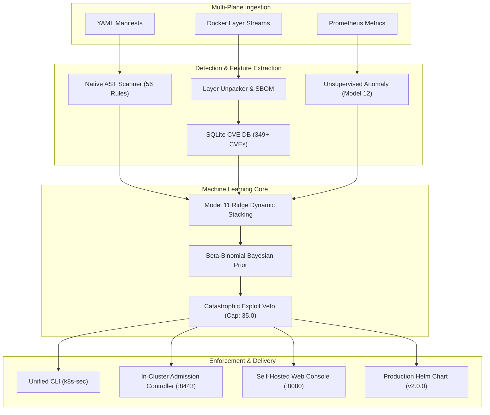

# Platform Documentation Index (v2.0.0)

Welcome to the technical documentation for the **Kubernetes ML Security Assessment Platform (v2.0.0)**.

---

## Documentation Roadmap

- **[Quickstart & Setup Guide](SETUP.md)**: Virtual environment setup, CLI installation, in-cluster Helm deployment, and test suite verification.
- **[56-Vulnerability Taxonomy Reference](VULNERABILITY_TAXONOMY_56_REFERENCE.md)**: Formal taxonomy specifications, security plane weights, CIS Benchmark mappings, and MITRE ATT&CK codes (Rules V01 through V56).
- **[Detailed Project Report](DETAILED_PROJECT_REPORT.md)**: Deep architectural thesis, mathematical formulations (AHP prior, Ridge meta-stacking, Beta-Binomial Bayesian updates, Exploit Veto logic), and empirical benchmarks against Kubescape and Trivy.
- **[Presentation Master Guide](PRESENTATION_MASTER_GUIDE.md)**: Executive slide deck scripts, architectural presentation walkthroughs, and conference briefing notes.

---

## Architecture Overview

---

## Primary Make & CLI Commands

| Command | Action | Key Output |
|---|---|---|
| `k8s-sec scan <path>` | Audit Kubernetes YAML manifests or directory | Detailed 56-rule AST scorecard + Model 11 score |
| `k8s-sec scan-image <tag>` | Stream Docker image in memory (< 600 ms) | Exact OS/Python SBOM + Matched CVE records |
| `k8s-sec remediate <manifest>` | Auto-harden insecure manifest | Remediated YAML + Unified hardening diff |
| `k8s-sec admission --port 8443` | Start in-cluster admission controller webhook | Active `/validate` & `/mutate` endpoints with TLS |
| `k8s-sec daemon --interval 15` | Run continuous Prometheus anomaly daemon | Online EMA learning baseline + `/metrics` exporter |
| `k8s-sec sync-cve --stats` | View embedded SQLite CVE database stats | Microsecond CVE package lookup table |
| `k8s-sec web --port 8080` | Start self-hosted Web Management Console | Real-time Dark-Mode UI at `http://localhost:8080` |
| `k8s-sec audit` | Compile executive compliance audit | Boardroom-ready PDF & HTML reports |
| `make test` | Run complete unit, rigor & chaos suite (596 tests) | 100% Mock-based test discovery with 100% pass rate |
| `./run_test.sh <category>` | Modular test runner for specific testcases | Granular sub-suite execution (taxonomy, ebpf, gitops, cli, etc.) |
| `helm lint charts/k8s-security` | Validate production Helm chart syntax | 0 errors, 100% lint pass |
